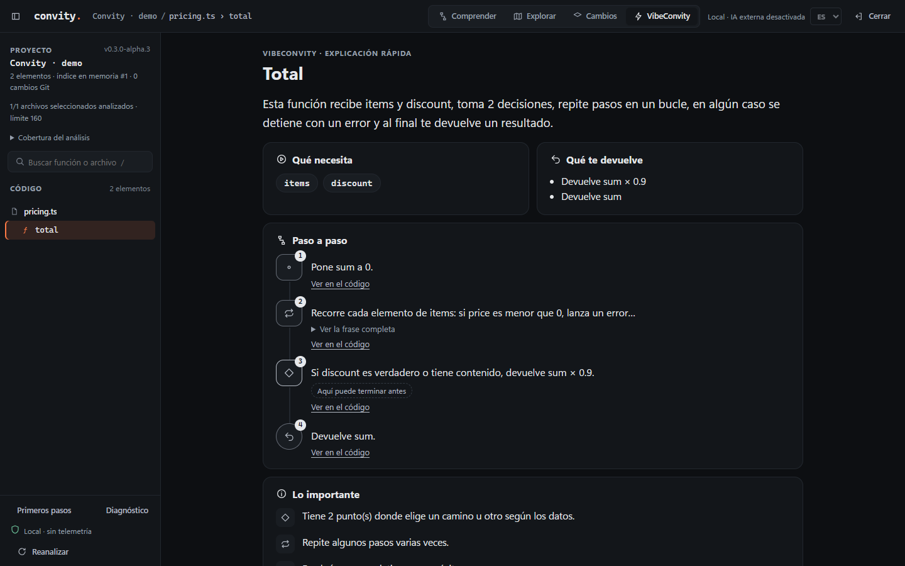
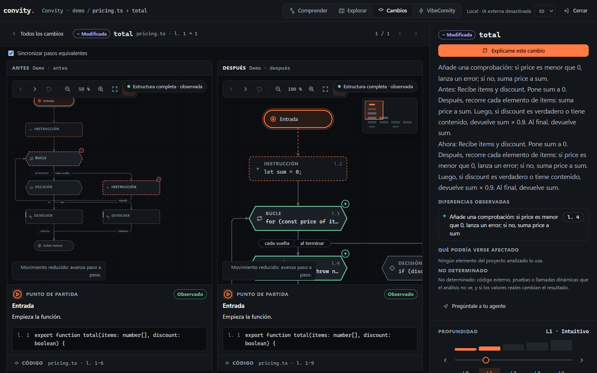
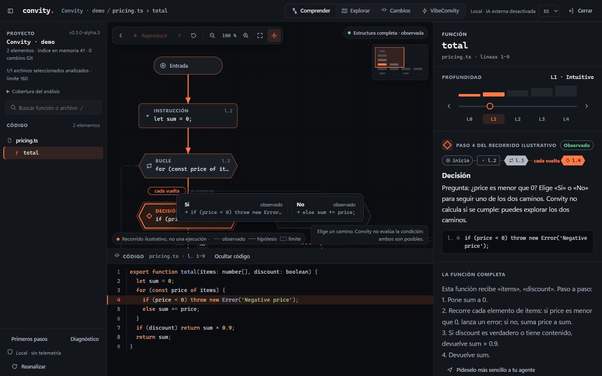

<h1 align="center">Convity — Entiende lo que ha construido tu agente de IA.</h1>

Explora el código, visualiza cómo se comporta y entiende qué ha cambiado después de Claude Code o Codex.

<b>Alpha privada · Windows 11 x64</b> · <a href="docs/ACCESS.md">Disponibilidad</a> · <a href="https://convity.es/">Web oficial</a> · <a href="README.md">English</a>

---

## El problema

Los agentes escriben mucho código y muy deprisa. Tras unas cuantas sesiones es fácil perder el hilo de tu propio proyecto: qué hace una función, qué caminos puede seguir y qué ha alterado de verdad el último cambio. Leer cada diff línea a línea no escala, y pedir un resumen a otro modelo te da un texto en el que tienes que confiar.

## Míralo en 15 segundos

*Pantallas reales con el proyecto de demostración (código sintético). Hay un [vídeo de 57 segundos](assets/demo/convity-demo-57s.webm) con el recorrido completo; su primera escena es ilustrativa y está rotulada como tal.*

## Qué hace Convity

Convity lee el código de una carpeta de tu ordenador y convierte cada función en algo que puedes explorar. Nunca ejecuta tu proyecto.

| Modo | Qué obtienes |
|---|---|
| **Comprender** | El grafo de flujo (CFG) de la función paso a paso junto a su código, con explicaciones desde lo sencillo (L0) hasta lo técnico (L4). |
| **Explorar** | Qué funciones usan esta y cuáles usa ella. Las coincidencias solo por nombre se marcan como hipótesis. |
| **Cambios** | Qué ha cambiado entre dos versiones: funciones nuevas, modificadas o eliminadas, el grafo antes y después y una explicación sencilla. |
| **VibeConvity** | Un resumen corto y sin jerga para quien empieza a programar. |

Cada afirmación indica en qué se basa: **observado** en el código, **declarado** por el autor, **hipótesis** o **límite** del análisis.

## VibeConvity: si casi no programas

Una frase sobre lo que hace la función, qué necesita, qué te devuelve y sus pasos con iconos. «Ver en el código» te lleva a la línea exacta cuando quieras más detalle.

## Antes y después

Elige con qué comparar (tu último commit de Git, dos commits o un análisis anterior) y abre un cambio. Verás las dos versiones lado a lado, la nueva condición en el grafo y una explicación ligada a las líneas que la justifican. Convity no dice saber *por qué* cambió algo ni quién lo cambió.

## Recorre el flujo sin ejecutarlo

Avanza por el grafo, detente en una decisión y elige qué rama seguir. Elegir «Sí» o «No» es explorar: Convity no evalúa la condición con datos reales.

## Funciona en tu ordenador

- El análisis es local. La alpha privada tiene la **IA externa bloqueada** y **no envía telemetría**.
- Los botones «Pregúntale a tu agente» solo **copian** una pregunta; tú decides si la pegas en Claude Code o Codex, con las condiciones de ese servicio.
- Convity lee archivos; no ejecuta tus scripts, no instala paquetes y no modifica tu repositorio.

Más detalle en [Privacidad](docs/PRIVACY.md) (en inglés).

## Compatibilidad (lo que se ha probado de verdad)

| | Estado |
|---|---|
| Paquete portable para Windows 11 x64 (Node.js y TypeScript incluidos) | Probado por el desarrollador en su equipo, incluida una extracción limpia con `PATH` vacío y una carpeta personal temporal. **Aún no probado en un segundo ordenador.** |
| Skill de Claude Code (`/convity`) | Usada de verdad en la app de escritorio de Claude Code en Windows 11 por el desarrollador. |
| Skill de Codex (`$convity`) | Usada de verdad en la app de Codex en Windows 11 por el desarrollador. |
| Lenguajes | JavaScript y TypeScript (incluidos). Python 3.9+ si está instalado en tu equipo. |
| macOS y Linux | Las pruebas automáticas se ejecutan en ellos en la CI, pero **no hay paquete** todavía. |

Convity no está afiliado a Anthropic ni a OpenAI. Claude Code y Codex son productos de sus respectivos propietarios.

## Cómo conseguirlo

Convity se prepara para una **alpha privada** con 3–5 testers invitados. Puedes [registrar tu interés](docs/ACCESS.md). Las invitaciones dependen de completar las comprobaciones de distribución y las condiciones de evaluación; no hay descarga pública.

1. Lee [qué incluye la alpha](docs/INSTALL.md) y sus [limitaciones](docs/LIMITATIONS.md) (en inglés).
2. [Solicita acceso](docs/ACCESS.md). Solo pedimos lo necesario para enviarte el paquete.

## Limitaciones

El análisis estático tiene límites: código dinámico, excepciones implícitas, tipos o código fuera de los archivos analizados pueden quedar fuera, y una explicación puede ser incompleta. Cuando Convity no sabe algo, lo dice en lugar de adivinar.

## Sobre este repositorio

Este repositorio contiene **solo material público de presentación**: este README, documentación, capturas y la web. **El código de Convity es propietario y no se publica aquí.** Convity no es software libre. Consulta [TERMS.md](TERMS.md).

© 2026 Roberto Martín Gutiérrez.
