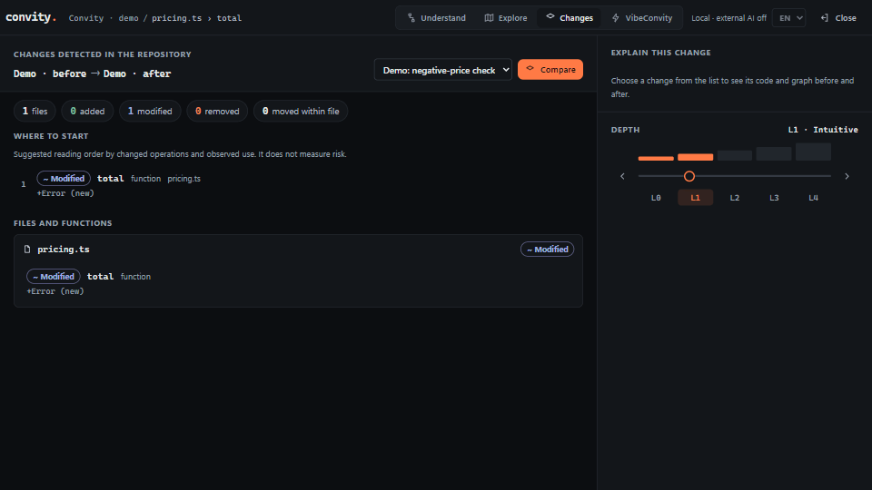
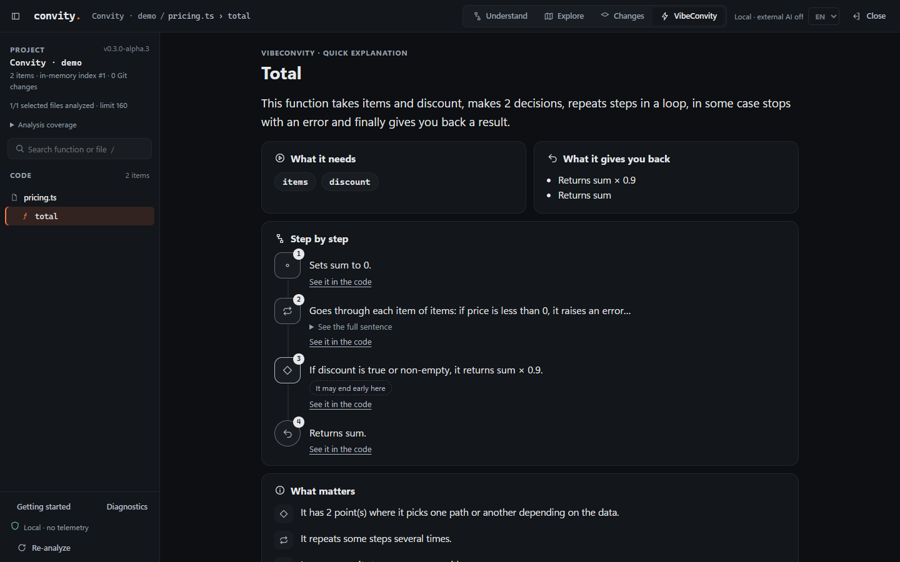
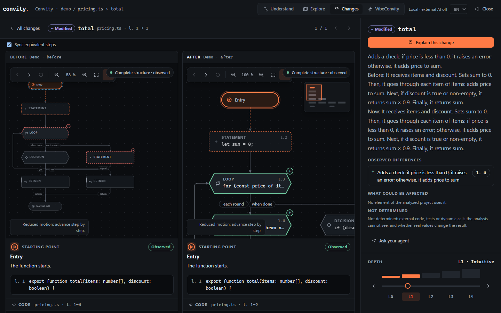
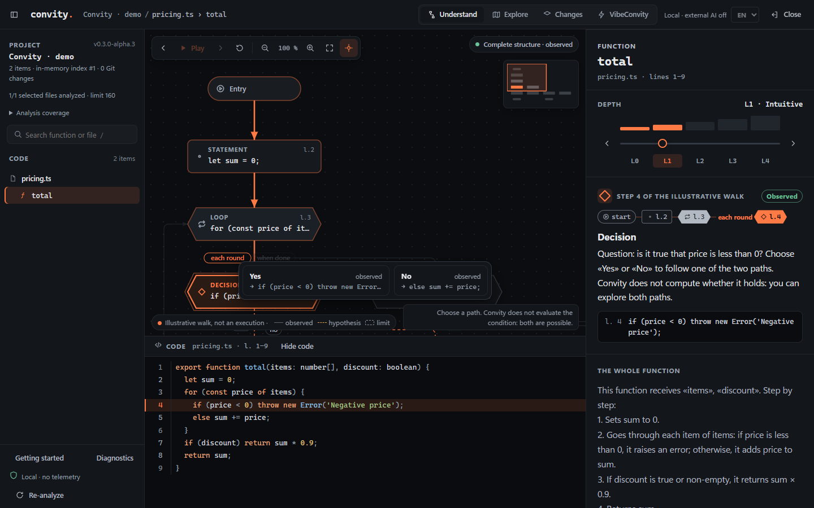

<h1 align="center">Convity — Understand what your AI coding agent built.</h1>

Explore code, visualize its behavior, and understand what changed after Claude Code or Codex.

<b>Private alpha · Windows 11 x64</b> · <a href="docs/ACCESS.md">Alpha availability</a> · <a href="https://convity.es/">Official website</a> · <a href="README.es.md">Español</a>

---

## The problem

Coding agents write a lot of code, fast. After a few sessions it is easy to lose track of how your own project works: what a function does, which paths it can take, and what the last change actually altered. Reading every diff line by line does not scale, and asking another model for a summary gives you text you still have to trust.

## See it in 15 seconds

*Real screens from the demo project (synthetic code). A [57-second video](assets/demo/convity-demo-57s.webm) shows the whole flow; its first scene is illustrative and labeled as such.*

## What Convity does

Convity reads the code in a folder on your computer and turns each function into something you can explore. It never runs your project.

| Mode | What you get |
|---|---|
| **Understand** | A step-by-step flow graph (CFG) of the function next to its code, with explanations from plain (L0) to technical (L4). |
| **Explore** | Which functions use this one and which it uses. Possible matches by name are marked as hypotheses. |
| **Changes** | What changed between two versions: new, modified or removed functions, the graph before and after, and a plain explanation. |
| **VibeConvity** | A short, jargon-free summary for people who are new to code. |

Every statement carries its basis: **observed** in the code, **declared** by the author, a **hypothesis**, or a **limit** of the analysis.

## VibeConvity: for people new to code

One sentence about what the function does, what it needs, what it gives back, and its steps with icons. "See it in the code" jumps to the exact line when you want more.

## Before and after

Pick a baseline (your last Git commit, two commits, or an earlier analysis) and open a change. Both versions are shown side by side, the new condition appears in the graph, and the explanation is linked to the lines that justify it. Convity does not claim to know *why* something changed or who changed it.

## Walk the flow without running it

Step through the graph, stop at a decision, and choose which branch to follow. Choosing "Yes" or "No" is exploration: Convity does not evaluate the condition with real data.

## Runs on your computer

- Analysis happens locally. The private alpha has **external AI blocked** and sends **no telemetry**.
- "Ask your agent" buttons only **copy** a question; you decide whether to paste it into Claude Code or Codex, under that service's own terms.
- Convity reads files; it does not execute your scripts, install packages or modify your repository.

More detail in [Privacy](docs/PRIVACY.md).

## Compatibility (what has actually been tested)

| | Status |
|---|---|
| Windows 11 x64 portable package (Node.js and TypeScript included) | Tested by the developer on their own machine, including a clean extraction with an empty `PATH` and a temporary home folder. **Not yet tested on a second computer.** |
| Claude Code skill (`/convity`) | Used for real in the Claude Code desktop app on Windows 11 by the developer. |
| Codex skill (`$convity`) | Used for real in the Codex app on Windows 11 by the developer. |
| Languages | JavaScript and TypeScript (included). Python 3.9+ if installed on your machine. |
| macOS and Linux | The test suite runs on them in CI, but there is **no package** for them yet. |

Convity is not affiliated with Anthropic or OpenAI. Claude Code and Codex are their respective owners' products.

## Getting it

Convity is being prepared for a **private alpha** with 3–5 invited testers. You can [register your interest](docs/ACCESS.md) now. Invitations await completion of distribution checks and evaluation terms; there is no public download.

1. Read [what the alpha includes](docs/INSTALL.md) and its [limitations](docs/LIMITATIONS.md).
2. [Request access](docs/ACCESS.md). We only ask for what we need to send you the package.

## Privacy

See [docs/PRIVACY.md](docs/PRIVACY.md). In short: local analysis, no account, no telemetry, external AI blocked in the alpha, and nothing leaves your computer unless you copy it yourself.

## Limitations

Static analysis has limits. Dynamic code, implicit exceptions, types and code outside the analyzed files can be missed, and an explanation can be incomplete. When Convity does not know something, it says so instead of guessing. Full list: [docs/LIMITATIONS.md](docs/LIMITATIONS.md).

## Feedback

Alpha testers report issues through a private channel shared with the invitation. For security issues, see [SECURITY.md](SECURITY.md). Questions about this page: [open an issue](https://github.com/convderover/convity-app/issues) — please do not post private code or personal data.

## About this repository

This repository holds **public presentation material only**: this README, documentation, screenshots and the website. **Convity's source code is proprietary and is not published here.** Convity is not open source. See [TERMS.md](TERMS.md).

© 2026 Roberto Martín Gutiérrez.
